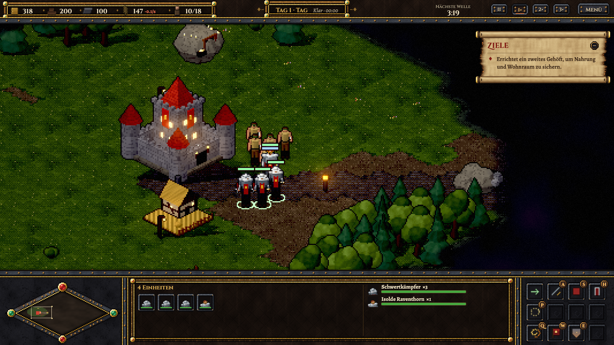

# ASHEN CROWNS – The Age of the Fallen

Eigenständiges Dark-Fantasy-Echtzeitstrategiespiel in **Rust** mit **eigener modularer Engine**
(wgpu · winit · WGSL · egui · kira). Zielplattform: **macOS (Apple Silicon)**, optimiert für einen
A18 Pro mit 5-Kern-GPU und 8 GB Unified Memory. Windows und Linux sind architektonisch vorbereitet.



## Stand: Phase 1 + spielbare Vertical Slice

| Bereich | Umgesetzt |
|---|---|
| Engine | Fenster/Hauptschleife, Eingabe, fester Simulationstakt, Deferred-2D-Renderer (G-Buffer, Normalen-Beleuchtung, Punktlichter, weiche Schatten per Scherung nach Sonnenstand, Wasser, Nebel, Regen, Aschefall, Blitze, Hitzeflimmern, Kriegsnebel, Bloom, Tonemapping, Farbkorrektur, Vignette), Partikelsystem, Animationssystem, Shader-Hot-Reload, Grafikprofile, Headless-Screenshots |
| Assets | 3D→Pixel-Bake nach dem Dead-Cells-Prinzip (Low-Poly-Modelle mit Skelettanimation, 5 Richtungen, prozedurale Materialien, Cel-Shading, Normalen für dynamisches Licht; ≈1500 Sprites beim Start), prozedurales 2D-Gelände, Atlas, PNG-Overrides |
| Simulation | Deterministisch (20 Hz), A*-Wegfindung mit Glättung und Budget, Formationen, Separation, Kampf mit Rüstungs-/Schadenstypen, Moral & Flucht, Projektile, Türme, Helden mit Stufen und Fähigkeiten, Wirtschaft (Sammeln, Bauen, Ausbilden, Nahrung als Unterhalt, Hungersnot), Tag/Nacht, Wetter, Gegner-KI (Wellen, Wachen, Boss), datengetriebene Missionen, Chronik |
| Inhalte | 30 eigene + 2 gegnerische Gebäude, 5 Einheitentypen, Heldin Isolde Raventhorn (3 Fähigkeiten), 3 Gegnertypen + Boss „Der Fahle Vogt“, Mission „Die letzte Siedlung“ |
| Wirtschaft & Städtebau | Echtzeit-Wirtschaft: 17 Waren (RON), Lager mit Kapazität, 26 neue Produktions-, Wohn- und Stadtgebäude mit Ketten (Holz→Bretter, Erz→Eisen→Waffen/Rüstung, Korn→Mehl→Brot, Wolle→Tuch→Kleidung, Bier, Kräuter), Arbeiter aus Wohnhäusern, Wohnstufen Hütte→Haus→Bürgerhaus mit Bedürfnissen, Zufriedenheit und einstellbaren Steuern, Markt mit dynamischen Preisen, Ausbau Bergfried→Burg, Mauern (als Linie gezogen), Tore und Mauertürme mit Torrechten in der Wegfindung, Belagerung von Mauern und Toren – siehe [Wirtschaft](docs/design/rts_economy.md) |
| Modi | Kampagne, Gefecht (mit Einrichtung: generierte Karten in sechs Vorlagen oder Szenario, Schwierigkeit, Startressourcen, Siegbedingung), Überleben, Sandbox, **Szenarien** (4 historische: Grauwall 893, Vael Dorn 894, Kaltherd 896, Grauwall 898; eigene und Mod-Szenarien), **Herausforderungen** (8 Regelvarianten mit Wertung und lokaler Bestenliste) – siehe [Editor und Szenarien](docs/design/editor_and_scenarios.md) |
| UI | Dark-Fantasy-Oberfläche aus prozedural erzeugter Pixel-Art (geschmiedete Eisenrahmen mit Goldfiligran und Edelsteinen, Leder, Stein, Pergament), Schriften Cinzel/Cinzel Decorative/Alegreya (OFL); Hauptmenü mit Glut-Titel und lebendem Hintergrund, Neues Spiel, Laden, Einstellungen, Mods, Credits; HUD mit Ressourcenplakette, Rauten-Minimap, Porträt im Prunkrahmen, Befehlskarte mit Abklingzeiten, Zielrolle, Nachrichten, Pausenmenü, Chronik, Sieg/Niederlage |
| Speichern | Versioniert, CRC32, atomar, Backup, rotierende Autosaves |
| Audio | Manifest, Asset-Scanner, automatische Zuordnung, Validierung, Duplikat-/Fehlbericht, Event-Registry, Musik-Intensitäten mit Crossfade, Ambience-Schichten, Dialogsequenzen mit Ducking |
| Modding | Datenmods (Einheiten, Gebäude, Fähigkeiten, Missionen, Szenarien, Herausforderungen) mit Beispiel-Mod |
| Karteneditor | Eigene Szene: Gelände-, Wald-, Deko-, Quellen-, Gebäude- und Einheitenwerkzeuge, Startpositionen, Bereiche, Trigger-Editor (alle Bedingungen und Aktionen), Ziele, Regeln, Rückgängig/Wiederholen, Prüfung, Testspiel, Speichern als spielbares RON-Szenario |

Geplant (siehe [Roadmap](docs/tech/roadmap.md)): Grand Campaign/Weltkarte, Dynastien, Diplomatie,
Religion, Magie-Schulen u. a.

## Starten

```bash
# Rust installieren: https://rustup.rs
cargo run --release                     # Spiel
cargo run --release -- --help           # Optionen (Profil, Vollbild, Screenshot-Modus)
cargo test --workspace                  # Tests
cargo run -p ashen_tools -- validate-data --mod mods/example_mod
cargo run -p ashen_tools -- audio-scan  # Audiodateien prüfen und zuordnen
```

Screenshot ohne Fenster (z. B. für Dokumentation oder CI):

```bash
cargo run --release -- --screenshot shot.png --scene mission --time 0.88 --battle --select-army
```

## Steuerung

| Aktion | Eingabe |
|---|---|
| Auswählen / Rahmen | Linksklick / Ziehen (Shift: hinzufügen, Doppelklick: gleiche Typen) |
| Bewegen, Angreifen, Sammeln, Reparieren | Rechtsklick (kontextabhängig), Shift: Befehl anhängen |
| Angriffsbewegung · Halt · Position halten · Patrouille | A · S · H · P |
| Bauen | B: Baumenü mit Rubriken (Wohnen, Rohstoffe, Handwerk, Nahrung, Stadt, Militär, Mauern); Mauern: Maustaste halten, ziehen, loslassen |
| Lager · Stadtübersicht (Steuern, Ausbau) | L · C |
| Fähigkeiten der Heldin | Q · W · E |
| Ausbilden (Gebäude gewählt) | Kürzel der Einheit (W, S, P, A, K), R: Sammelpunkt |
| Kontrollgruppen | Cmd/Strg + 0–9 setzen, 0–9 wählen (zweimal: Kamera) |
| Kamera | Pfeiltasten, Bildschirmrand, mittlere Maustaste, Mausrad (Zoom), Leertaste (Auswahl), Pos1 (Heldin) |
| Spieltempo · Pause | + / − · ^ |
| Schnellspeichern · -laden · Menü | F5 · F9 · Esc |
| Alle Lebensbalken | Alt halten |

## Dokumentation

- [Kanon (verbindliche Namen/IDs)](docs/canon.md)
- [Game Design Document](docs/design/game_design_document.md) · [Kampagne](docs/design/campaign.md) · [Echtzeit-Wirtschaft](docs/design/rts_economy.md) · [Editor, Szenarien, Herausforderungen](docs/design/editor_and_scenarios.md)
- [Weltbibel](docs/lore/world_bible.md) · [Glossar](docs/lore/glossary.md)
- [Architektur](docs/tech/architecture.md) · [Module](docs/tech/modules.md) · [Datenmodell](docs/tech/data_model.md) · [Projektstruktur](docs/tech/project_structure.md) · [Roadmap](docs/tech/roadmap.md) · [Modding](docs/tech/modding.md)
- [Grafik & Shader](docs/art/graphics_and_shaders.md) · [3D→Pixel-Pipeline](docs/art/3d_pixel_pipeline.md) · [Asset-Produktionsplan](docs/art/asset_production_plan.md)
- Audio: [ElevenLabs-Leitfaden](docs/audio/elevenlabs_production_guide.md), [Figuren](docs/audio/elevenlabs_characters.md), [Einheiten](docs/audio/elevenlabs_unit_voices.md), [Dialoge](docs/audio/elevenlabs_dialogues.md), [Soundeffekte](docs/audio/elevenlabs_sound_effects.md), [Ambience](docs/audio/elevenlabs_ambient_audio.md), [Suno-Musik](docs/audio/suno_master_production.md), [Audio-Integration](docs/audio/audio_integration.md)

## Bekannte Einschränkungen

- Figuren und Bauwerke sind im Code modellierte Low-Poly-3D-Modelle (kein externes 3D-Werkzeug); ein glTF-Import für professionell modellierte Assets ist geplant. Handgezeichnete Sprites können über `assets/sprites/` eingespielt werden.
- Audiodateien sind noch nicht geliefert; das Spiel läuft ohne sie und meldet fehlende Dateien im Audio-Bericht.
- Entwickelt und automatisiert geprüft unter Linux mit Software-Vulkan (llvmpipe); ein Lauf auf echter macOS-Hardware (Metal) steht noch aus.
