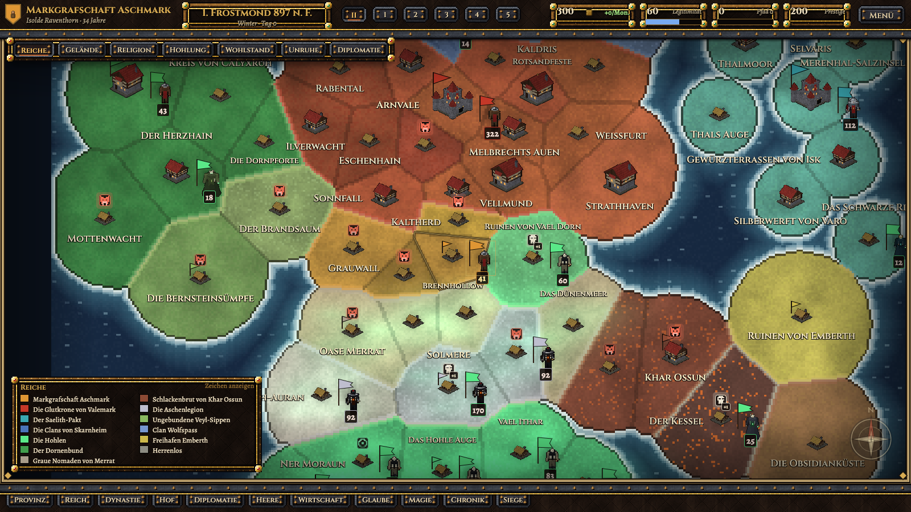
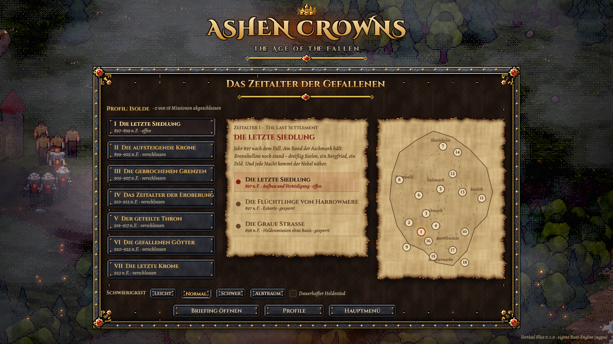
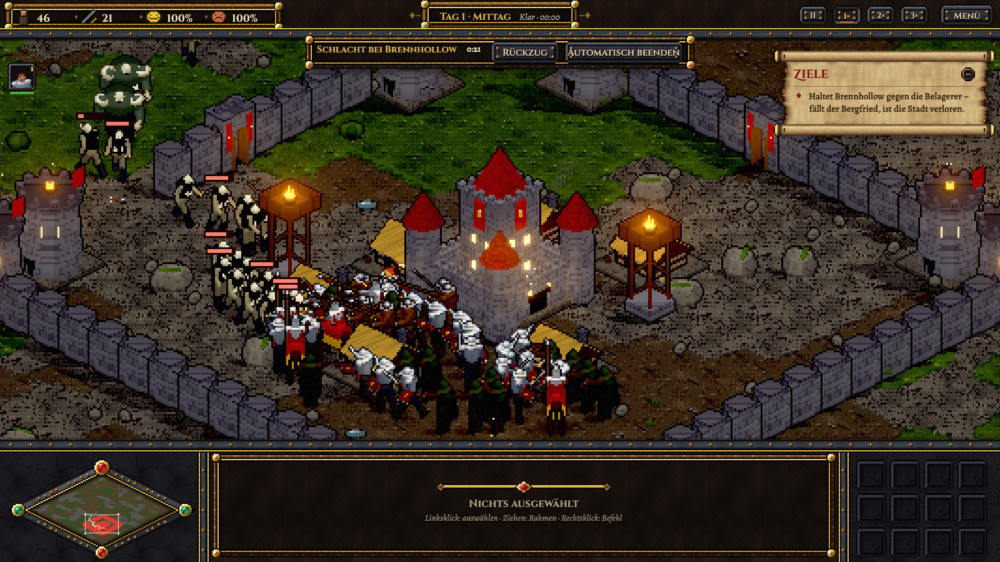
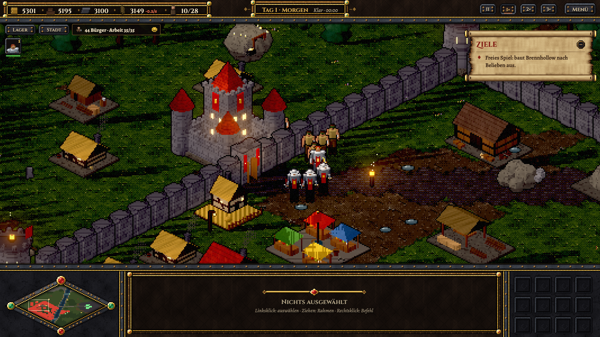
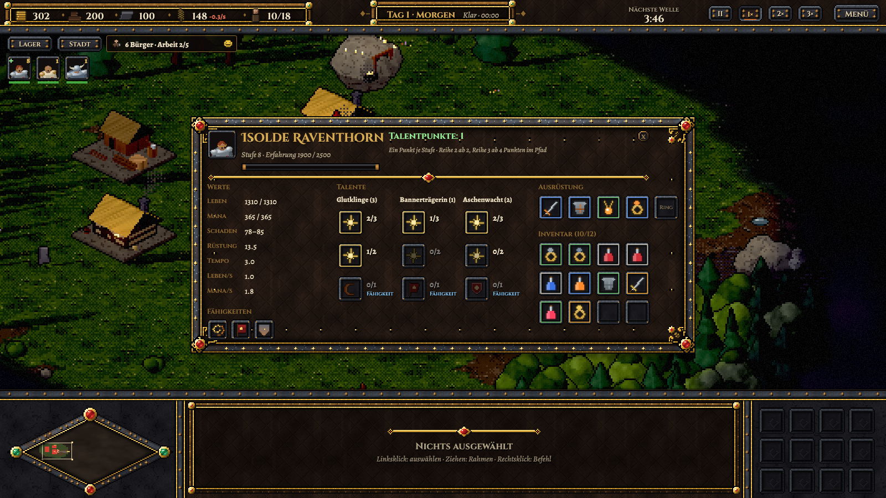
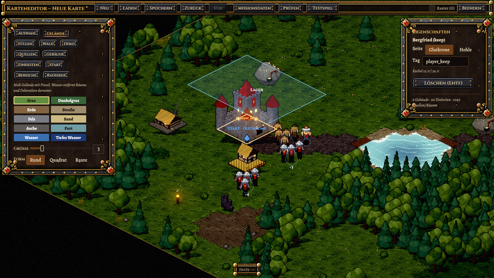

# ASHEN CROWNS – The Age of the Fallen

Eigenständiges Dark-Fantasy-Echtzeitstrategiespiel in **Rust** mit **eigener modularer Engine**
(wgpu · winit · WGSL · egui · kira). Zielplattform: **macOS (Apple Silicon)**, optimiert für einen
A18 Pro mit 5-Kern-GPU und 8 GB Unified Memory. Windows und Linux sind architektonisch vorbereitet.


## Stand: alle Entwicklungsphasen außer Sounddesign umgesetzt

Spielbar und automatisiert getestet sind die Echtzeit-Kampagne „Das Zeitalter der Gefallenen“, die Große Kampagne auf der
Weltkarte von Eldraeth (mit wahlweise selbst gespielten Echtzeitschlachten), Gefecht, Überleben, Sandbox, Szenarien,
Herausforderungen und ein Karteneditor. **Offen:** die Audio-Dateien selbst (Manifest, Scanner, Import und
[Produktionsliste](docs/audio/PRODUCTION_CHECKLIST.md) sind fertig); Mehrspieler/Wiederholungen und ein Mod-Manager sind **nicht
umgesetzt**; 18 von 29 entworfenen Kampagnenmissionen sind spielbar. Phasenstatus: [Roadmap](docs/tech/roadmap.md).

### Galerie

| | |
|---|---|
|  |  |
| Große Kampagne: Weltkarte im Kartenmodus „Reiche“ | Echtzeit-Kampagne: Zeitalter, Missionen, Pergamentkarte |
|  |  |
| Echtzeitschlacht mit Mauern, Türmen und Belagerern | Stadt mit Wohnhäusern, Markt, Mauern und Toren (Vorführstadt der Sandbox) |
|  |  |
| Heldenfenster: Werte, Talente, Ausrüstung, Inventar | Karteneditor mit Werkzeugleiste und Eigenschaften |

### Umfang

| Bereich | Umgesetzt |
|---|---|
| Engine | Fenster/Hauptschleife, Eingabe, fester Simulationstakt (20 Hz), Deferred-2D-Renderer (G-Buffer, Normalen-Beleuchtung, Punktlichter, weiche Schatten per Scherung nach Sonnenstand, Wasser, Nebel, Regen, Aschefall, Blitze, Hitzeflimmern, Kriegsnebel, Bloom, Tonemapping, Farbkorrektur, Vignette), Partikelsystem, Animationssystem, Shader-Hot-Reload, drei Grafikprofile (Leistung, Ausgewogen, Qualität), Headless-Screenshots |
| Grafik / Assets | 3D→Pixel-Bake nach dem Dead-Cells-Prinzip (Low-Poly-Modelle mit Skelettanimation, 5 Richtungen, prozedurale Materialien, Cel-Shading, Normalen für dynamisches Licht; Atlas mit 4 492 Sprites, siehe [Performance](docs/tech/performance.md)), prozedurales 2D-Gelände, PNG-Overrides – siehe [3D→Pixel-Pipeline](docs/art/3d_pixel_pipeline.md) |
| Simulation | Deterministisch (20 Hz, `state_hash`), A*-Wegfindung mit Glättung und Budget, Formationen, Separation, Kampf mit Rüstungs-/Schadenstypen, Moral & Flucht, Projektile, Türme, Tag/Nacht, Wetter, Gegner-KI (Wellen, Wachen, Boss), datengetriebene Missionen mit Triggern, Chronik |
| Inhalte (`assets/data`) | 43 Gebäudetypen (36 der Glutkrone, 7 der Hohlen), 30 Einheitentypen (17 Glutkrone inkl. 2 Arbeitertypen und 3 Helden, 13 Hohle inkl. 5 Bosse), 30 Fähigkeiten, 25 Gegenstände, 17 Waren, 18 Echtzeitmissionen (Mission 1 plus 17 Kampagnenmissionen), 4 Szenarien, 8 Herausforderungen, 6 Ereignisdateien der Strategieebene |
| Echtzeit-Wirtschaft | 17 Waren (RON), Lager mit Kapazität, 26 Produktions-, Wohn- und Stadtgebäude mit Ketten (Holz→Bretter, Erz→Eisen→Waffen/Rüstung, Korn→Mehl→Brot, Wolle→Tuch→Kleidung, Bier, Kräuter), Arbeiter aus Wohnhäusern, Wohnstufen Hütte→Haus→Bürgerhaus mit Bedürfnissen, Zufriedenheit und einstellbaren Steuern, Markt mit dynamischen Preisen, Ausbau Bergfried→Burg, Mauern (als Linie gezogen), Tore und Mauertürme mit Torrechten in der Wegfindung, Belagerung von Mauern und Toren – siehe [Wirtschaft](docs/design/rts_economy.md) |
| Echtzeit-Militär | Konter-Matrix mit Feuerschaden, Belagerung (Mindestreichweite, Flächenschaden, Projektilbögen), Flieger, Heiler und Beschwörer mit Autocast, Schmiede-Upgrades 1–3, Burg-Freischaltungen, Formationen (Linie, Keil, Kolonne, Karree), Helden (Isolde Raventhorn, Bruder Hal Venn, Torvald Eisenhand) bis Stufe 10 mit Talenten, Ausrüstung (Waffe, Rüstung, Amulett, 2 Ringe), Inventar, Beute, Wiederbeleben am Altar, Heldenfenster, KI-Spieler der Hohlen im Gefecht (4 Schwierigkeitsgrade), taktische Führung in Weltkarten-Schlachten – siehe [Militär](docs/design/rts_military.md) |
| Echtzeit-Kampagne | **„Das Zeitalter der Gefallenen“**: 7 Zeitalter, 18 spielbare Missionen mit je eigener Karte, Missionstypen von Aufbau & Verteidigung über Eskorte, Heldenmission, Rettung, Wettlauf und Belagerung bis zur Endschlacht, Bosse (Fahler Vogt, Isarre Mol, Wurzelmutter, Gharun, Hohler König), 14 Entscheidungen mit Folgen (Kampagnen-Flags verändern spätere Missionen), 4 Enden, Heldenfortschritt über alle Missionen, Kampagnenmenü mit Pergamentkarte, Briefing, Entscheidungsfenster und Zusammenfassung, fünf Profile im Benutzerordner – siehe [Kampagne](docs/design/campaign.md) |
| Große Kampagne / Strategieebene | Crate `ashen_strategy` (deterministisch, ohne Grafik): Eldraeth mit 50 Kern- und 14 optionalen Provinzen, 12 Reiche, Dynastien mit Nachfolge, Adelshäuser, Ämter und Intrigen, Diplomatie mit Verträgen, Kriegsgründen und KI, Wirtschaft (57 Waren, 54 Gebäude, Märkte, Handelsrouten), Bevölkerung nach Schichten, 6 Religionen, Magie und Hohlung, datengetriebene Ereignisse, neutrale Akteure und Bosse, Chronik, 8 Siegziele. Im Spiel (Hauptmenü → Große Kampagne): Provinzkarte mit sieben Kartenmodi, Heere, Fenster für Provinz, Reich, Dynastie, Hof, Diplomatie, Heere, Wirtschaft, Glaube, Magie, Chronik und Siegziele; Schlachten selbst kommandieren (Echtzeitschlacht aus dem `BattleRequest`, Ergebnis fließt zurück) oder automatisch auflösen; Spielstände `.acstrat` – siehe [Strategieebene](docs/tech/strategy_layer.md) und [Bedienung](docs/design/grand_campaign_ui.md) |
| Modi | Kampagne, Gefecht (Einrichtung: generierte Karten in sechs Vorlagen oder Szenario, Schwierigkeit, Startressourcen, Siegbedingung), Überleben, Sandbox, **Szenarien** (4 historische: Grauwall 893, Vael Dorn 894, Kaltherd 896, Grauwall 898; eigene und Mod-Szenarien), **Herausforderungen** (8 Regelvarianten mit Wertung und lokaler Bestenliste), Große Kampagne – siehe [Editor und Szenarien](docs/design/editor_and_scenarios.md) |
| Karteneditor | Eigene Szene: Gelände-, Wald-, Deko-, Quellen-, Gebäude- und Einheitenwerkzeuge, Startpositionen, Bereiche, Trigger-Editor (alle Bedingungen und Aktionen), Ziele, Regeln, Rückgängig/Wiederholen, Prüfung, Testspiel, Speichern als spielbares RON-Szenario |
| UI | Dark-Fantasy-Oberfläche aus prozedural erzeugter Pixel-Art (geschmiedete Eisenrahmen mit Goldfiligran und Edelsteinen, Leder, Stein, Pergament), Schriften Cinzel/Cinzel Decorative/Alegreya (OFL); Hauptmenü mit Glut-Titel und lebendem Hintergrund, Neues Spiel, Laden, Einstellungen, Mods, Credits; HUD mit Ressourcenplakette, Rauten-Minimap, Porträt im Prunkrahmen, Befehlskarte mit Abklingzeiten, Zielrolle, Nachrichten, Lager-, Stadt-, Markt- und Heldenfenster, Pausenmenü, Chronik, Sieg/Niederlage |
| Speichern | Versioniert, CRC32, atomar, Backup, rotierende Autosaves; `.acsave` (Echtzeit), `.acstrat` (Große Kampagne) |
| Audio | Manifest, Asset-Scanner, automatische Zuordnung, Validierung, Duplikat-/Fehlbericht, Import eines Lieferordners, Event-Registry, Musik-Intensitäten mit Crossfade, Ambience-Schichten, Dialogsequenzen mit Ducking; vollständige Produktionsliste (alle Stimmen Deutsch) – **Audio-Dateien noch nicht geliefert** |
| Modding | Datenmods (Einheiten, Gebäude, Fähigkeiten, Missionen, Szenarien, Herausforderungen) mit Beispiel-Mod – siehe [Modding](docs/tech/modding.md) |
| Werkzeuge (`ashen_tools`) | `audio-scan`, `audio-list`, `validate-data`, `forge-scenarios`, `forge-campaign`, `rts-balance`, `strategy-stats` (Aufrufe unter „Starten“) |
| Performance / Benchmark | `ashen_crowns --bench <szene>` (CPU-Zeit je Frame-Abschnitt, Instanzen, Draw-Calls, GPU-Zeit je Pass), Sim-Benchmark `sim_bench`; 400 Einheiten im Kampf: Simulationstick 0,46 ms im Mittel (Budget 50 ms), Frame-CPU ≈ 1 ms (Linux, Software-Vulkan) – siehe [Performance](docs/tech/performance.md) |

Neu erzeugen lässt sich die Kampagne reproduzierbar mit `cargo run -p ashen_tools -- forge-campaign` (Missionen, Plan, Audio-Events, Sprechskript); `cargo run -p ashen_tools -- validate-data` prüft sie.

## Starten

```bash
# Rust installieren: https://rustup.rs
cargo run --release                     # Spiel
cargo run --release -- --help           # Optionen (Profil, Vollbild, Screenshot-Modus)
cargo test --workspace                  # Tests
cargo run -p ashen_tools -- validate-data --mod mods/example_mod
cargo run -p ashen_tools -- audio-scan  # Audiodateien prüfen und zuordnen
cargo run -p ashen_tools -- audio-scan --import <lieferordner>   # gelieferte Audiodateien einsortieren
cargo run -p ashen_tools -- audio-list  # alle erwarteten Audiodateien auflisten (--format csv, --out)
cargo run -p ashen_tools -- forge-scenarios # historische Szenarien neu erzeugen
cargo run -p ashen_tools -- forge-campaign  # Echtzeit-Kampagne neu erzeugen
cargo run --release -p ashen_tools -- rts-balance --seeds 12 --minutes 30    # Gefecht-KI gegen Testspieler
cargo run --release -p ashen_tools -- strategy-stats --seeds 12 --years 200  # Balance der Strategieebene
cargo run --release -- --bench stress:200 --no-audio                          # Benchmark (CPU, Draw-Calls, GPU je Pass)
```

Screenshot ohne Fenster (z. B. für Dokumentation oder CI):

```bash
cargo run --release -- --screenshot shot.png --scene mission --time 0.88 --battle --select-army
cargo run --release -- --screenshot siege.png --scene sandbox --demo siege --select-army --camera 25,32 --time 0.5 --sim-seconds 12   # Belagerung
cargo run --release -- --screenshot hero.png --scene mission --demo hero --ui hero --sim-seconds 2                                      # Heldenfenster
cargo run --release -- --screenshot welt.png --scene worldmap --map-mode realms --size 1600x900                                         # Weltkarte
cargo run --release -- --screenshot editor.png --scene editor --editor-demo                                                             # Karteneditor
```

## Steuerung

| Aktion | Eingabe |
|---|---|
| Auswählen / Rahmen | Linksklick / Ziehen (Shift: hinzufügen, Doppelklick: gleiche Typen) |
| Bewegen, Angreifen, Sammeln, Reparieren | Rechtsklick (kontextabhängig), Shift: Befehl anhängen |
| Angriffsbewegung · Halt · Position halten · Patrouille | A · S · H · P |
| Bauen | B: Baumenü mit Rubriken (Wohnen, Rohstoffe, Handwerk, Nahrung, Stadt, Militär, Mauern); Mauern: Maustaste halten, ziehen, loslassen |
| Lager · Stadtübersicht (Steuern, Ausbau) | L · C (oder Schaltflächen oben links) |
| Fähigkeiten (Held, Priester, Magier, Schildträger …) · Zielzauber | Q · W · E · R · T · Y, danach Linksklick |
| Formation wechseln · Heldenfenster | F · H (nur Helden oder nichts gewählt, schließt es auch wieder) oder Klick auf das Heldenporträt |
| Ausbilden (Gebäude gewählt) | Kürzel der Einheit (siehe Tooltip), R: Sammelpunkt; Schmiede-Upgrades und Wiederbeleben über die Befehlskarte |
| Kontrollgruppen | Cmd/Strg + 0–9 setzen, 0–9 wählen (zweimal: Kamera) |
| Kamera | Pfeiltasten, Bildschirmrand, mittlere Maustaste, Mausrad (Zoom), Leertaste (Auswahl), Pos1 (Heldin) |
| Spieltempo (0–3×) · Pause | + / − · Pause-Taste oder ^ |
| Schnellspeichern · -laden · Menü | F5 · F9 · Esc oder F10 (Esc bricht zuerst einen Befehlsmodus ab bzw. schließt das Heldenfenster) |
| Große Kampagne: Karte | Ziehen / Pfeiltasten / WASD / Bildschirmrand, Mausrad oder +/− (Zoom), Linksklick wählt Provinz oder Heer, Rechtsklick schickt das gewählte Heer, Tab wechselt den Kartenmodus |
| Große Kampagne: Zeit und Fenster | Leertaste Pause, 1–5 Tempo, P Provinz · R Reich · F Dynastie · H Hof · T Diplomatie · M Heere · E Wirtschaft · G Glaube · Z Magie · C Chronik · V Siegziele, Esc Menü |
| Karteneditor | Strg/Cmd+Z Rückgängig · Strg/Cmd+Shift+Z oder Strg/Cmd+Y Wiederholen · Strg/Cmd+S Speichern · G Raster · Entf Auswahl löschen · Esc Dialog/Auswahl/Werkzeug zurücksetzen |
| Alle Lebensbalken | Alt halten |

## Dokumentation

- [Kanon (verbindliche Namen/IDs)](docs/canon.md)
- [Game Design Document](docs/design/game_design_document.md) · [Kampagne (Missionsliste, Entscheidungsbaum, Enden)](docs/design/campaign.md) · [Echtzeit-Wirtschaft](docs/design/rts_economy.md) · [Editor, Szenarien, Herausforderungen](docs/design/editor_and_scenarios.md) · [Echtzeit-Militär](docs/design/rts_military.md) · [Bedienung der Großen Kampagne](docs/design/grand_campaign_ui.md)
- [Weltbibel](docs/lore/world_bible.md) · [Glossar](docs/lore/glossary.md)
- [Architektur](docs/tech/architecture.md) · [Module](docs/tech/modules.md) · [Datenmodell](docs/tech/data_model.md) · [Projektstruktur](docs/tech/project_structure.md) · [Strategieebene](docs/tech/strategy_layer.md) · [Performance](docs/tech/performance.md) · [Roadmap](docs/tech/roadmap.md) · [Entwicklungsprotokoll](docs/tech/development_log.md) · [Modding](docs/tech/modding.md)
- [Grafik & Shader](docs/art/graphics_and_shaders.md) · [3D→Pixel-Pipeline](docs/art/3d_pixel_pipeline.md) · [Asset-Produktionsplan](docs/art/asset_production_plan.md)
- Audio: [ElevenLabs-Leitfaden](docs/audio/elevenlabs_production_guide.md), [Figuren](docs/audio/elevenlabs_characters.md), [Einheiten](docs/audio/elevenlabs_unit_voices.md), [Dialoge](docs/audio/elevenlabs_dialogues.md), [Soundeffekte](docs/audio/elevenlabs_sound_effects.md), [Ambience](docs/audio/elevenlabs_ambient_audio.md), [Suno-Musik](docs/audio/suno_master_production.md), [Audio-Integration](docs/audio/audio_integration.md), [Audio-Produktionsliste (alle Dateien, Prompts, Einstellungen)](docs/audio/PRODUCTION_CHECKLIST.md)

## Bekannte Einschränkungen

- **Audio:** Audiodateien sind noch nicht geliefert; das Spiel läuft ohne sie und meldet fehlende Dateien im Audio-Bericht. Die Integration erfolgt nach Lieferung (`audio-scan --import`).
- **Hardware:** Entwickelt und automatisiert geprüft unter Linux mit Software-Vulkan (llvmpipe); alle Messwerte stammen von dort. Eine Messung auf echter Apple-Hardware (A18 Pro, Metal) steht noch aus ([Performance](docs/tech/performance.md) §6).
- **Assets:** Figuren und Bauwerke sind im Code modellierte Low-Poly-3D-Modelle (kein externes 3D-Werkzeug); ein glTF-Import für professionell modellierte Assets ist geplant. Handgezeichnete Sprites können über `assets/sprites/` eingespielt werden. Das Backen der Sprites beim Start dauert auf Software-Vulkan rund 5 s; ein Festplatten-Cache ist geplant.
- **Spielstände:** Alte Spielstände früherer Formatversionen sind nicht kompatibel (aktuell Format 4, keine Migration; inkompatible Dateien werden mit Meldung abgelehnt).
- **Balance:** Die Werte sind mit skriptgesteuerten Testspielern und KI-Beobachterläufen eingestellt ([Militär](docs/design/rts_military.md) §10.5, [Strategieebene](docs/tech/strategy_layer.md) §19); lange menschliche Testsitzungen fehlen.
- **Kampagne:** Von 29 entworfenen Missionen sind 18 umgesetzt ([Kampagne](docs/design/campaign.md)).
- **Nicht umgesetzt:** Mehrspieler und Wiederholungen (nur vorbereitet: Befehle als Daten, `state_hash`), Mod-Manager (nur Ein-/Ausschalten), Tutorial, Lokalisierung (nur Deutsch), Barrierefreiheits-Optionen, Installationspakete und CI.
- **Editor:** keine Höhenstufen, keine Weltkarten-Szenarien, nur eine Spielerseite ([Editor](docs/design/editor_and_scenarios.md) §7).
