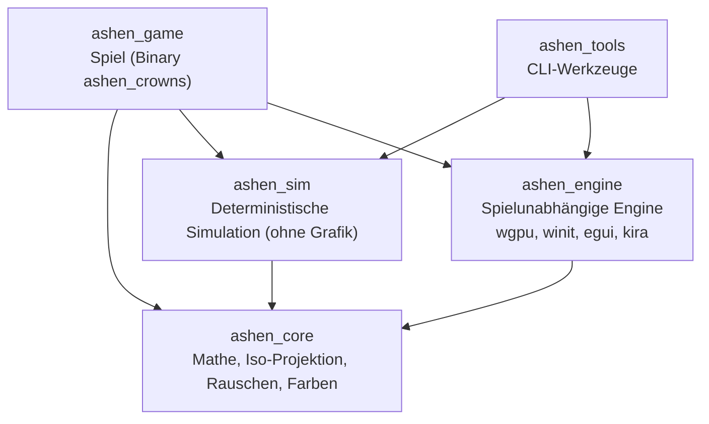
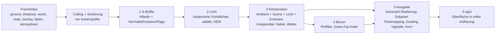

# ASHEN CROWNS – Architekturüberblick

Stand: Vertical Slice (Mission 1 „Die letzte Siedlung“, `m01_last_settlement`) und Phase 1 der Roadmap
(Technisches Fundament). Dieses Dokument beschreibt den **tatsächlichen Code-Stand**. Was noch nicht
implementiert ist, ist ausdrücklich als „geplant“ mit Roadmap-Phase gekennzeichnet (siehe
[`roadmap.md`](roadmap.md)).

Verwandte Dokumente: [`modules.md`](modules.md) (Modulübersicht), [`data_model.md`](data_model.md)
(Datenmodell), [`project_structure.md`](project_structure.md) (Verzeichnisse und Befehle),
[`modding.md`](modding.md), [`../art/graphics_and_shaders.md`](../art/graphics_and_shaders.md),
[`../audio/audio_integration.md`](../audio/audio_integration.md).

---

## 1. Leitprinzipien

| Prinzip | Umsetzung |
|---|---|
| Eigene Engine | Kein fertiges Spiel-Framework: `wgpu` (Grafik), `winit` (Fenster/Eingabe), `egui` (Oberfläche), `kira` (Audio). |
| Simulation ohne Grafik | `ashen_sim` kennt weder Fenster noch GPU und ist ohne Renderer lauffähig und testbar. |
| Engine spielunabhängig | `ashen_engine` kennt `ashen_sim` nicht. Das Spiel verbindet beides über das Trait `Game`. |
| Daten statt Code | Einheiten, Gebäude, Fähigkeiten, Regeln, Missionen und Audio-Manifest liegen als RON-Dateien unter `assets/`. |
| Determinismus | Fester Takt (20 Hz), `ChaCha8Rng`, Befehle als serialisierbare Daten, `SimWorld::state_hash()`. |
| Robustheit | Fehlerhafte Mods, Shader, PNG-Overrides, Spielstände und Audiodateien führen zu Meldungen und Rückfällen, nicht zu Abstürzen. |
| Zielhardware zuerst | Low-Res-Rendering mit Ganzzahl-Skalierung, Instancing, ein Atlas, Budgets (Licht, Partikel, Wegsuche). |

---

## 2. Schichten und Abhängigkeiten

Die fünf Workspace-Crates (`Cargo.toml`, Edition 2024, `rust-version = "1.88"`) bilden folgende Schichten:

| Schicht | Crate | Verantwortung | Interne Abhängigkeiten |
|---|---|---|---|
| 0 | `ashen_core` | Mathe-Re-Exporte (`glam`), isometrische Projektion, Rauschen, Farben/Rampen | – |
| 1 | `ashen_sim` | Deterministische RTS-Simulation (Zustand, Systeme, Daten, Missionen, Spielstände) – **ohne Grafik** | `ashen_core` |
| 1 | `ashen_engine` | Spielunabhängige 2D-Engine: Fenster, Hauptschleife, Renderer, Atlas, UI-Integration, Audio | `ashen_core` |
| 2 | `ashen_game` | Das Spiel: Inhalte laden, prozedurale Kunst, Szenen, HUD, Weltdarstellung, Audio-Brücke | `ashen_core`, `ashen_sim`, `ashen_engine` |
| 3 | `ashen_tools` | Kommandozeilenwerkzeuge (`audio-scan`, `validate-data`) | `ashen_sim`, `ashen_engine` |

Die lineare Lesart „core → sim → engine → game → tools“ beschreibt die konzeptionelle Schichtung. Der
tatsächliche Abhängigkeitsgraph ist ein Diamant: **`ashen_sim` und `ashen_engine` kennen einander nicht**; nur
`ashen_game` führt beide zusammen. `ashen_tools` hängt von `ashen_sim` und `ashen_engine` ab, nicht von
`ashen_game`.



Externe Abhängigkeiten (Workspace-Versionen aus `Cargo.toml`):

| Crate | Version | Verwendet von |
|---|---|---|
| `wgpu` | 30.0 | `ashen_engine` |
| `winit` | 0.30 | `ashen_engine` |
| `egui`, `egui-wgpu`, `egui-winit` | 0.37 | `ashen_engine`, `ashen_game` (nur `egui`) |
| `kira` | 0.12 (optional, Feature `audio`) | `ashen_engine` |
| `glam` | 0.34 (`serde`, `bytemuck`) | alle Crates |
| `bytemuck`, `image` (nur PNG), `pollster` | 1.25 / 0.25 / 1.0 | `ashen_engine` |
| `serde`, `ron` 0.12 | 1.0 / 0.12 | `ashen_core`, `ashen_sim`, `ashen_engine`, `ashen_game` |
| `serde_json`, `bincode` 2.0, `uuid`, `crc32fast` | – | `ashen_sim` (Spielstände) |
| `rand` 0.10, `rand_chacha` 0.10 | – | `ashen_sim` |
| `log`, `env_logger` | 0.4 / 0.11 | alle bzw. Binaries |

Das Cargo-Feature `audio` (Standard an) in `ashen_engine` und `ashen_game` schaltet die echte Audioausgabe über
`kira`. Ohne das Feature läuft das Audiosystem stumm (`NullBackend`); Manifest, Scanner und Event-Logik bleiben
funktionsfähig.

Build-Profile (`Cargo.toml`): `dev` mit `opt-level = 1` und Abhängigkeiten mit `opt-level = 3`; `release` mit
`lto = "thin"`, `codegen-units = 4`, `panic = "abort"`, `debug = false`.

---

## 3. Hauptschleife und fester Simulationstakt

### 3.1 Engine-Schleife (`ashen_engine::app`)

`ashen_engine::run(config, game)` startet eine `winit`-Ereignisschleife mit `ControlFlow::Poll`. In
`about_to_wait` wird jedes Mal ein Redraw angefordert; die Bildrate wird damit allein durch VSync
(`PresentMode::AutoVsync`) bzw. `AutoNoVsync` begrenzt. Das Spiel implementiert das Trait `Game`:

| Methode | Aufgabe |
|---|---|
| `init(&mut Engine)` | Einmalig nach GPU-Start: Inhalte laden, Atlas hochladen, Menü öffnen. |
| `update(&mut Engine, dt)` | Spiellogik mit variabler Frame-Zeit; hier läuft der feste Simulationstakt. |
| `ui(&mut Engine, &mut egui::Ui)` | Oberfläche (egui) zeichnen. |
| `render(&mut Engine)` | `engine.frame` (Sprites, Lichter, Atmosphäre) füllen. |
| `on_exit(&mut Engine)` | Aufräumen (das Spiel speichert hier `settings.ron`). |

Ablauf eines Frames (`run_frame` in `app.rs`; identisch im Fenster- und im Headless-Betrieb):

1. `renderer.hot_reload(dt)` – Shader-Änderungen prüfen (nur mit `ASHEN_SHADER_DIR`).
2. `game.update(engine, dt)` – Eingabe auswerten, Simulation vorwärtsbewegen.
3. egui-Eingabe holen, `game.ui(...)` ausführen; `ui_wants_pointer`/`ui_wants_keyboard` für die nächste Eingabe setzen.
4. `frame.clear()`, `game.render(engine)` – `FrameData` füllen.
5. `renderer.render(...)` – alle Szenen-Passes aufzeichnen (siehe Abschnitt 5).
6. `ui.paint(...)` – egui über das fertige Bild zeichnen.
7. `audio.update(dt)`, `input.end_frame()`.

Die Frame-Zeit (`FrameTimer::tick`) wird auf **100 ms** begrenzt (Debugger, Fensterverschieben). Im
Headless-Betrieb wird sie fest vorgegeben (`tick_fixed`, 1/60 s).

### 3.2 Fester Takt und Interpolation

Die Simulation läuft unabhängig von der Bildrate mit **`Rules::tick_rate` = 20 Hz** (`assets/data/rules.ron`,
Standard 20; ein Schritt = 50 ms). Die Missionsszene (`ashen_game::mission::MissionScene`) hält dafür einen
`ashen_engine::time::FixedStep`:

```text
steps = FixedStep::advance(dt * speed)      // Akkumulator, max. 8 Schritte pro Frame
for _ in 0..steps { world.step(data); Ereignisse → Darstellung, Audio, HUD }
alpha = FixedStep::alpha()                  // 0..1 Position zwischen letztem und nächstem Schritt
```

* `max_steps = 8`: Reicht die Frame-Zeit für mehr Schritte, wird der Rest des Akkumulators verworfen
  (Schutz vor der „Spirale des Todes“).
* Spielgeschwindigkeit `speed` 0 bis 3 (Tasten `+`/`-`, Pause mit `Pause` oder `^`/Backquote). Bei Pause, geöffnetem
  Menü oder beendeter Mission werden keine Schritte ausgeführt.
* **Interpolation:** `SimWorld::step` kopiert zu Beginn jedes Schritts `pos` nach `prev_pos` (Einheiten) bzw.
  `Projectile::prev_pos`. `WorldView::render` zeichnet `prev_pos.lerp(pos, alpha)`, wodurch Bewegungen bei 60 Hz
  oder höher flüssig erscheinen. Gebäude und Ressourcenquellen sind statisch und werden nicht interpoliert.
* Teilsysteme laufen mit eigenen, niedrigeren Raten (Tick-Vielfache bei 20 Hz):

| System | Rate | Stelle |
|---|---|---|
| Befehle, Umwelt, Wirtschaft, Wellen-Direktor, Einheiten, Bewegung, Kampf | jeden Tick (20 Hz) | `SimWorld::step` |
| Kriegsnebel | jeden 4. Tick (5 Hz) | `SimWorld::step`, `systems::fog::update` |
| Missionsskript (Auslöser, Sieg/Niederlage) | jeden 10. Tick (2 Hz) | `systems::script::tick` |
| Wellenziele, Boss-/Zaubererverhalten, überlebte Wellen | jeden 20. Tick (1 Hz) | `systems::ai::tick` |

Reihenfolge in `SimWorld::step` (nach Prüfung `mission.outcome.is_none()`):

```text
tick += 1; time += dt; prev_pos sichern
Befehle anwenden (pending → systems::commands::apply)
environment::tick → economy::tick → ai::tick
SpatialGrid neu aufbauen
units::tick → movement::process_paths → movement::integrate
combat::tick → units::status_tick → combat::cleanup_dead
fog::update (jeden 4. Tick) → script::tick (jeden 10. Tick) → economy::hero_respawn
```

Ist `mission.outcome` gesetzt (Sieg oder Niederlage), ist die Simulation eingefroren (`step` kehrt sofort zurück).

---

## 4. Determinismus

Ziel: Gleicher Start (Daten, Mission, `MatchSettings`, Seed) plus gleiche Befehlsfolge ergibt zu jedem Tick
denselben Zustand.

| Baustein | Umsetzung |
|---|---|
| Zufall | Genau ein `ChaCha8Rng` in `SimWorld::rng`, initialisiert mit `settings.seed ^ 0xA5_4E_C0_0D`. Verwendet für Wetterwechsel/Blitze (`Environment::tick`) und Wellenzusammensetzung (`ai::spawn_wave`). Der RNG-Zustand ist Teil des Spielstands. |
| Kartengenerierung | Kein RNG-Strom, sondern zustandslose Hash-Rauschfunktionen (`ashen_core::noise`) mit `map_seed` und `settings.seed`. |
| Befehle als Daten | `Command` / `PlayerCommand` sind `Serialize`/`Deserialize`. Die UI erzeugt nur Befehle (`SimWorld::push_command`); die Simulation wendet sie am Anfang des nächsten Ticks an. |
| Iterationsreihenfolge | `Arena<T>` iteriert in Indexreihenfolge; Slots werden über Freiliste mit Generationszähler wiederverwendet (`Id<T>` verhindert hängende Referenzen). |
| Feste Zeitschritte | `dt = 1 / tick_rate`; keine Abhängigkeit von Wanduhr oder Bildrate. |
| Hash | `SimWorld::state_hash()` bildet eine CRC32-Prüfsumme über Einheiten (Index, Position, HP als Bitmuster), Gebäude (HP, Baufortschritt), Ressourcen aller Spieler und den Tick. |
| Nicht serialisierter Laufzeitzustand | `events`, `pending`, `pathfinder`, `spatial`, `scratch` sind `#[serde(skip)]` und werden bei Bedarf neu aufgebaut. |

Absicherung: Der Test `simulation_is_deterministic` (`crates/ashen_sim/tests/simulation.rs`) startet zwei Welten
mit gleichem Befehl, simuliert 2 Spielminuten (2 400 Ticks) und vergleicht `state_hash()`.

Grenzen (ehrlich): Die Simulation rechnet in `f32`. Bit-Gleichheit ist auf derselben Plattform und demselben
Compiler gegeben; über unterschiedliche Plattformen hinweg ist sie nicht gesondert abgesichert oder getestet.
Ein Replay-Rekorder und Lockstep-Netzcode existieren noch nicht; das Datenmodell (`Command` als Daten,
`state_hash` zur Desync-Erkennung) ist dafür vorbereitet. Mehrspieler und Wiederholungen sind **geplant
(Phase 14)**.

---

## 5. Frame-Ablauf des Renderers

Der Renderer (`ashen_engine::render::Renderer`) ist ein **Deferred-2D-Renderer** für isometrische Pixel-Art. Alle
Szenen-Passes laufen in einer niedrigen **internen Auflösung**; erst der letzte Pass skaliert ganzzahlig auf die
Ausgabegröße. Details zu Shadern, Materialien und Kodierungen: [`graphics_and_shaders.md`](../art/graphics_and_shaders.md).



| # | Pass | Eingaben | Ausgabe (Format) | Draws |
|---|---|---|---|---|
| 0 | Vorbereitung (CPU) | `FrameData` | Instanzpuffer, Lichtpuffer, `Globals`-Uniform | – |
| 1 | G-Buffer | Atlas (Albedo + Normalen), Instanzen | `g-albedo` (`Rgba8UnormSrgb`), `g-normal` (`Rgba8Unorm`) | bis zu 5: Boden, Schatten, Welt, Hitze, Overlay |
| 2 | Licht | `g-normal`, Lichtinstanzen | `light` (`Rgba16Float`) | 1 (instanziert) |
| 3 | Komposition | `g-albedo`, `g-normal`, `light`, Nebeltextur (`R8Unorm`) | `scene` (`Rgba16Float`) | 1 (Vollbilddreieck) |
| 4 | Bloom | `scene` | Kette `bloom0..n` (`Rgba16Float`, jeweils halbe Größe) | `levels` Down- plus `levels-1` Up-Passes |
| 5 | Ausgabe | `scene`, `bloom0` | Fenster-/Headless-Ziel | 1 |
| 6 | egui | – | gleiches Ziel (egui-wgpu) | – |

Vorbereitung im Detail (`Renderer::render`):

1. `Camera2D::view(output, min_lines)` bestimmt Pixelskalierung, interne Auflösung, Ursprung und Subpixel-Versatz.
2. Das `Globals`-Uniform (16 × `vec4`/`mat4`) wird einmal pro Frame geschrieben: Kamera, Zeit, Umgebungs- und
   Sonnenlicht, Nebel, Wetter, Kriegsnebel, Farbgebung, Bloom.
3. **Culling:** Jede Sprite-Instanz wird gegen die sichtbare Weltfläche (4 Pixel Rand, Scherungsbreite
   berücksichtigt) geprüft. Zusätzlich beschränkt `WorldView::render` den Boden auf den sichtbaren Kachelbereich.
4. `frame.world` wird nach Tiefenschlüssel (`x + y` der Kachelposition) sortiert; alle Gruppen landen in **einem**
   Instanzpuffer (Start 8 192 Instanzen, wächst in Zweierpotenzen). Aufteilung in fünf Bereiche (`ranges`).
5. Lichter außerhalb des Bildes werden verworfen; übersteigt der Rest `max_lights`, bleiben die Lichter mit dem
   größten Produkt aus Intensität und Radius.

G-Buffer-Reihenfolge (jeweils eine instanzierte Zeichnung mit 6 Vertices je Sprite):

```text
Boden (gbuffer) → Schatten (shadow, schreibt nur Normal.a) → Weltobjekte, tiefen­sortiert (gbuffer)
→ Hitzeflimmern (heat, schreibt nur Albedo.a) → unbeleuchtete Overlays (gbuffer)
```

Es gibt **keinen Tiefenpuffer**: Die Zeichenreihenfolge ist die Sortierung (Painter’s Algorithm). Schatten
liegen deshalb nur auf dem Boden; spätere Weltobjekte überschreiben die Schattenmaske.

Zielgrößen werden bei Änderung von interner Auflösung, Bloom-Stufen oder Nebeltexturgröße neu angelegt
(`ensure_targets`). Der Wechsel des Grafikprofils (`set_profile`) verwirft die Ziele und legt sie beim nächsten
Frame neu an.

---

## 6. Headless-Rendering

`ashen_engine::run_headless(config, game, frames, dt, out)` rendert ohne Fenster:

* `GpuContext::headless()` erzeugt Instanz und Adapter ohne Oberfläche (`PowerPreference::LowPower`).
* Zielformat `Rgba8Unorm` (Nicht-sRGB; der Ausgabe-Shader kodiert Gamma selbst).
* Das Spiel läuft über dieselbe `run_frame`-Funktion wie im Fenster; `Engine::headless = true`, Audio-Ausgabe aus.
* Nach `frames` Frames (Standard 90) wird das Zielbild in einen Readback-Puffer kopiert (Zeilenausrichtung auf
  256 Byte) und als PNG gespeichert (`image::save_buffer`).
* Am Ende wird `RenderStats` per `log::info!` ausgegeben.

Genutzt wird das für Sichtprüfungen, Dokumentationsbilder (`screenshots/`) und CI. Die Optionen stehen in
[`project_structure.md`](project_structure.md) (Abschnitt „Screenshot-Optionen“). Der Mechanismus `AutoRun`
in `ashen_game::game` setzt dafür Szene, Zeit, Wetter, Kamera und eine vorgezogene Angriffswelle.

---

## 7. Audio-Architektur

Audio ist in drei Ebenen getrennt (`ashen_engine::audio`):

| Ebene | Modul | Aufgabe |
|---|---|---|
| Daten | `manifest.rs` | `AudioManifest` (RON): Musikspuren, Events, Ambience-Schichten; Muster wie `voices/units/archer_move_*`. |
| Dateizuordnung | `scanner.rs` | Durchsucht `assets/audio`, ordnet Dateien Mustern zu, meldet fehlende/ungültige/doppelte/beschädigte Dateien, Umbenennungs- und Konvertierungsvorschläge; Markdown-Bericht. |
| Logik | `mod.rs` (`AudioSystem`) | Events mit Cooldown und Instanzbegrenzung, Variantenwahl ohne direkte Wiederholung, Dialogwarteschlange mit Ducking, Musikintensitäten mit Hysterese und Crossfade, Ambience-Schichten. |
| Ausgabe | `backend.rs` | Trait `AudioBackend`; `KiraBackend` (Feature `audio`) oder `NullBackend` (stumm, protokolliert Aufrufe, Tests). |

Das Mischpult besteht aus fünf Bussen (`Bus::Music`, `Sfx`, `Voice`, `Ambience`, `Ui`), je ein `kira`-Subtrack.
Lautstärken (`Volumes`) werden mit der Master-Lautstärke multipliziert und in Dezibel gesetzt.

Die **Spielseite** liegt in `ashen_game::audio_bridge`: Sie übersetzt `SimEvent`s in Audio-Events (mit Stereo-Pan
und Distanzdämpfung relativ zur Bildschirmmitte), leitet die **Musikintensität** aus dem Spielzustand ab und
wählt die **Ambience-Schichten** aus Tageszeit, Wetter und Kameraposition. Die Engine kennt keine Spielbegriffe;
sie bekommt nur Event-IDs wie `sfx.sword_hit`.

Es sind aktuell **keine Audiodateien** im Repository (`assets/audio/**/.gitkeep`, `audio_report.md` meldet
0 gefundene und 124 fehlende Muster). Das System läuft ohne Dateien stumm und ohne Fehler; fehlende Events werden
einmalig auf Debug-Ebene protokolliert. Die Details stehen in
[`../audio/audio_integration.md`](../audio/audio_integration.md).

---

## 8. Asset-Pipeline

Alle Sprites entstehen beim Start **prozedural** in `ashen_game::art` und landen in **einem Atlas**:

```text
ArtLibrary::build(assets_dir)
  terrain::build   Bodenkacheln (10 Terrains × 4 Varianten), Übergänge, Brücke, Fundamente
  units::build     Figuren mit Animationen und Porträts
  buildings::build Gebäude, Gerüste, Banner, BuildingMeta (Lichter, Rauch, Feuer)
  props::build     Bäume, Minen, Steinbruch, Dekoration
  fx::build        Partikel, Schatten, Auswahlringe, Projektile, Marker
  icons::build     16×16-Symbole
  PNG-Overrides    assets/sprites/<name>.png (+ <name>_n.png) ersetzen gleichnamige Sprites
  AtlasBuilder::build  Regal-Packer (Shelf Packing), 1 px Abstand, Breite ab 512 px wachsend
```

Jedes Sprite ist eine `Canvas` (`ashen_engine::assets::pixel`) mit Albedo (`Rgba`) und `NormalPx` (Normale x/y,
Emission, `fixed`-Flag). Organische Formen erhalten „Kissen-Normalen“ (`Canvas::pillow_normals`) aus einer
Distanztransformation der Silhouette; PNG-Overrides ohne `_n`-Datei werden mit `pillow_normals(0.8)` versehen.
Der Atlas besteht aus zwei Texturen (Albedo `Rgba8UnormSrgb`, Normalen/Emission `Rgba8Unorm`) und wird einmalig
mit `Renderer::set_atlas` hochgeladen. Fehlende Sprite-Namen liefern ein magenta Schachbrett (`__missing`) und eine
Logmeldung. Namenskonventionen und Produktionsplan: [`../art/asset_production_plan.md`](../art/asset_production_plan.md).

Datenassets (RON) werden von `ashen_game::content::Content::load` geladen: Basisdaten aus `assets/data`, danach
aktivierte Mods (`GameData::apply_overlay`), danach alle Missionen aus `assets/data/missions` und aus den
`data/missions`-Ordnern aktiver Mods. Siehe [`modding.md`](modding.md).

Asset-Verzeichnis finden (`ashen_engine::assets::find_assets_dir`): Reihenfolge `ASHEN_ASSETS` → neben der
ausführbaren Datei (`assets/`, `../Resources/assets` im macOS-App-Bundle, bis zu vier Ebenen aufwärts) →
Arbeitsverzeichnis und bis zu vier Ebenen aufwärts. Ein Verzeichnis gilt nur, wenn es einen Unterordner `data` enthält.

---

## 9. Fehlerbehandlung

| Bereich | Verhalten |
|---|---|
| Start | Fehlt das Asset-Verzeichnis oder sind Basisdaten ungültig, zeigt das Spiel ein egui-Fenster „Fehler“ mit Meldung und „Beenden“ (`AshenGame::fatal`) statt zu abstürzen. |
| GPU-Fehler | `device.on_uncaptured_error` protokolliert wgpu-Fehler per `log::error!`. Verlorene oder veraltete Oberflächen werden neu konfiguriert (`Outdated`/`Lost`), `Timeout`/`Occluded` überspringen den Frame. |
| Shader | `shaders::compile` fängt Validierungsfehler über einen Error-Scope ab. Beim Hot-Reload bleibt bei einem Fehler die zuletzt funktionierende Pipeline aktiv. Beim ersten Start liefert ein Fehler `Err` aus `Renderer::new`. |
| Spieldaten | `GameData::load_dir` meldet `DataError::{Io, Parse, Invalid}` mit Dateipfad; `validate()` prüft Querverweise (Trainingslisten, Fähigkeiten, Beschwörungen, Gebäudeanforderungen, Größen). |
| Mods | Ein ungültiger Mod wird mit Fehlermeldung in `Content::errors` im Mod-Menü angezeigt und nicht als aktiv geführt. Ungültige `mod.ron` erzeugen nur eine Warnung (`log::warn!`). |
| Missionen | Fehlerhafte Missionsdateien landen in `Content::errors`; unbekannte Platzierungs-IDs lassen `SimWorld::new` mit `Err` scheitern. |
| Spielstände | Siehe Abschnitt 10; Prüfsumme, Versionscheck, Kompatibilitätscheck, Backup-Rückfall. |
| Einstellungen | Fehlerhafte `settings.ron` → Warnung und Standardwerte; Schreibfehler werden nur protokolliert. |
| Sprites | Fehlende Atlas-Namen → Ersatz-Sprite; defekte PNG-Overrides → Warnung, prozedurales Sprite bleibt. |
| Audio | Kein Audiogerät → `NullBackend`; fehlendes Manifest → leeres Manifest (Warnung); fehlende Dateien → Event wird übersprungen. Siehe `audio_integration.md`. |
| Befehle | Ungültige Befehle (zu wenig Ressourcen, Warteschlange voll, kein Wohnraum, Bauplatz belegt, Mana, Abklingzeit) erzeugen ein `SimEvent::Error` für den Spieler (Toast + Fehlerklang), keine Panik. |

Die Release-Konfiguration nutzt `panic = "abort"`; Logik-Fehler sollen daher über `Result`/Meldungen laufen und
nicht über Panics. Logging: `env_logger`, Standardfilter des Spiels `info,wgpu_core=warn,wgpu_hal=warn,naga=warn`,
überschreibbar per `RUST_LOG`.

---

## 10. Spielstände (Kurzüberblick)

`ashen_sim::save` schreibt Dateien `*.acsave`: Magic `ASHC`, Formatversion, JSON-Header (für schnelle
Spielstandlisten), CRC32 über den bincode-Payload, Länge, Payload (`SimWorld`, Typtabelle, Client-Zustand).
Schreiben ist atomar (temporäre Datei, `fsync`, vorherige Version als `.acsave.bak`, Umbenennen). Beim Laden greift
bei beschädigter Datei automatisch das Backup. Autosaves rotieren über drei Slots. Das vollständige Format steht in
[`data_model.md`](data_model.md), Abschnitt „Spielstandformat“.

---

## 11. Plattformstrategie

| Plattform | Status | Grundlage |
|---|---|---|
| **macOS (Apple Silicon), Metal** | **Zielplattform, jetzt** | `wgpu` wählt Metal; `GpuContext` fordert den energieeffizienten Adapter (`LowPower`); Nutzerdaten unter `~/Library/Application Support/AshenCrowns`; `Cmd` als Befehlsmodifikator (`Input::command_mod`); Asset-Suche kennt `Contents/Resources/assets` im App-Bundle. |
| Windows | **vorbereitet** (nicht getestet) | Code enthält Pfade (`%APPDATA%\AshenCrowns`), `Strg` als Modifikator, `wgpu` mit DX12/Vulkan-Backends. Kein CI, kein Installer. |
| Linux | **vorbereitet** (nutzbar für Entwicklung und Headless) | XDG-Pfade (`$XDG_DATA_HOME/ashen_crowns`), `winit`-Features `x11` und `wayland`; die Dokumentation wurde u. a. auf Linux-Containern ohne Fenster erzeugt. |

Plattformabhängiges ist an wenigen Stellen gebündelt: `settings::data_dir()`, `assets::find_assets_dir()`,
`Input::command_mod()`, Surface-Format-Wahl in `app.rs` (bevorzugt Nicht-sRGB), Audio-Backend (kira:
CoreAudio/WASAPI/ALSA). Verteilung als signierte `.app`, Windows-Installer und Linux-Pakete gehören zu **Phase 15**
(Politur) und sind noch nicht umgesetzt.

---

## 12. Performance-Strategie für die Zielhardware

Zielhardware laut `render/profile.rs`: **Apple A18 Pro, 5-Kern-GPU, 8 GB Unified Memory**.
Das Rendering ist pixelfüllratenbewusst entworfen.

### 12.1 Low-Res-Internal-Target und Ganzzahl-Skalierung

`Camera2D` speichert `target_lines` (gewünschte sichtbare Bildzeilen). `Camera2D::view` rechnet:

```text
lines  = max(target_lines, profile.min_lines)
scale  = clamp(round(Ausgabehöhe / lines), 1, 16)      // ganzzahlig!
intern = (ceil(Breite / scale) + 2, ceil(Höhe / scale) + 2)   // 2 Pixel Rand
```

Alle Szenen-Passes laufen mit `intern`; der Ausgabe-Pass skaliert per Nearest-Sampler ganzzahlig und verschiebt um
den Subpixel-Anteil der Kamera (weiches Scrollen ohne Pixelflimmern). Beispiel: Ausgabe 1600×900,
`target_lines = 330` (Startwert der Missionsszene), Profil Ausgewogen (`min_lines = 260`): `scale = round(900/330) = 3`,
interne Auflösung **536×302** (≈ 162 000 Pixel, rund 11 % der 1,44 Mio. Ausgabepixel). Zoom: Mausrad ändert
`target_lines` im Bereich 220–480; `min_lines` des Profils begrenzt das Heranzoomen nach unten.

### 12.2 Weitere Maßnahmen

| Maßnahme | Umsetzung |
|---|---|
| **Instancing** | Jedes Sprite ist eine Instanz (`SpriteInstance`, 80 Byte), gezeichnet mit `draw(0..6, instances)`. Lichter ebenso (`Light`, 48 Byte). Keine Vertexpuffer pro Objekt. |
| **Ein Atlas** | Albedo- und Normalen-Atlas sind je eine Textur; nur wenige Draw Calls pro Frame (typisch 8–15, siehe `RenderStats.draw_calls`). |
| **Culling** | Kachelbereich im Spiel (`WorldView::render`), Rechtecktest je Instanz im Renderer, Lichttest gegen die Sicht. Einheiten und Gebäude außerhalb der Sicht oder im Nebel werden nicht erzeugt. |
| **Lichtbudget** | `max_lights` je Profil (48 / 128 / 256); Lichter werden instanziert additiv gezeichnet, nicht pro Pixel in einer Schleife. Überzählige Lichter: hellste/größte zuerst. |
| **Partikelbudget** | `ParticleSystem::max` aus `max_particles` des Profils (600 / 1 600 / 3 200); bei vollem Puffer wird das Partikel mit dem geringsten Restlebensanteil ersetzt. Partikel-Emission der Gebäude ist auf 0,12 s gedrosselt. |
| **Budgetierte A\*-Suche** | `systems::movement::process_paths`: höchstens **48 Wegsuchen** und **24 000 expandierte Knoten pro Tick**, einzelne Suche höchstens 6 000 Knoten. Bei erschöpftem Budget wird ein Teilpfad zum Knoten mit der besten Heuristik verwendet; unbearbeitete Anfragen bleiben `path_pending` und werden im nächsten Tick abgearbeitet. Der `Pathfinder` hält seine Puffer dauerhaft (Stempeltechnik, keine Allokation je Anfrage). |
| Nachbarschaftssuche | `SpatialGrid` (Zellgröße 2 Kacheln) wird einmal pro Tick neu aufgebaut. |
| Kriegsnebel | Simulation nur mit 5 Hz; GPU-Textur (1 Byte pro Kachel) wird nur bei neuer `revision` hochgeladen. |
| Statische Vorberechnung | `WorldView::prepare` berechnet Farbvariation, Wassertiefe und Brückenkacheln einmal pro Karte. |
| Speicher | Zwei Atlas-Texturen, ein halbes Dutzend Zielpuffer in interner Auflösung; Bloom-Kette wird mit jeder Stufe um den Faktor 4 kleiner. Kein Streaming von Texturen nötig. |
| Energie | `PowerPreference::LowPower`, VSync standardmäßig an. |

### 12.3 Grafikprofile (`ashen_engine::render::profile`)

Konkrete Werte aus `GraphicsProfile::settings()`:

| Einstellung | Leistung (`Performance`) | Ausgewogen (`Balanced`, Standard) | Qualität (`Quality`) |
|---|---|---|---|
| `bloom_levels` | 0 (kein Bloom) | 3 | 4 |
| `max_lights` | 48 | 128 | 256 |
| `max_particles` | 600 | 1 600 | 3 200 |
| `normal_mapping` | aus | an | an |
| `fog` (atmosphärischer Nebel) | an | an | an |
| `grain` (Filmkorn) | 0,0 | 0,012 | 0,018 |
| `min_lines` | 300 | 260 | 220 |

Hinweise:

* Der Kommentar zu `Performance` in `profile.rs` nennt zusätzlich „halbe Lichtauflösung“. Im Renderer ist der
  Lichtpuffer jedoch in allen Profilen so groß wie die interne Auflösung; eine halbe Lichtauflösung ist **nicht**
  implementiert.
* `fog` ist in allen drei Profilen `true`. Das Feld kann den atmosphärischen Nebel nur ausschalten (setzt die Dichte auf 0);
  Unterschiede in der Nebelqualität bestehen derzeit nicht.
* Das Profil wird in den Einstellungen gewählt (`UserSettings::profile`, gespeichert in `settings.ron`) oder per
  `--profile <performance|balanced|quality>`. Der Wechsel zur Laufzeit wirkt sofort auf den Renderer; die
  Partikelobergrenze einer bereits laufenden Szene wird erst beim Start der nächsten Szene angepasst.
* Die FPS-/Statistikanzeige (`show_fps`) zeigt FPS, mittlere und maximale Frame-Zeit, Sprites, Lichter, Draw Calls
  sowie interne Auflösung und Skalierung.

---

## 13. Erweiterungspunkte für kommende Phasen

| Vorhaben | Anknüpfungspunkt | Phase |
|---|---|---|
| Weltkarte als zweite Ebene | Neue Szene neben `Scene::Menu`/`Scene::Mission` in `ashen_game::game`; Simulation der Weltkarte als eigenes Modul in `ashen_sim` | 3 |
| Mehrspieler/Replays | `PlayerCommand`-Strom aufzeichnen/senden, `state_hash` zum Desync-Abgleich | 14 |
| Karteneditor | Datenmodell `TileMap`/`MissionDef` ist serialisierbar; Editor-Szene fehlt (Menüeintrag ist deaktiviert) | 14 |
| Weitere Plattformen | Siehe Abschnitt 11 | 15 |
| Eigene Sprites/Animationen | PNG-Override-Konvention, Animationsclips (`AnimationSet`) | laufend, siehe `asset_production_plan.md` |
